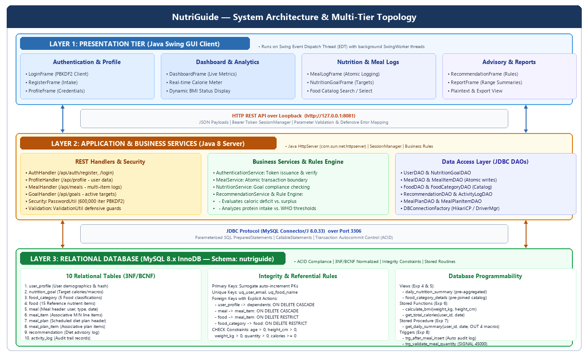
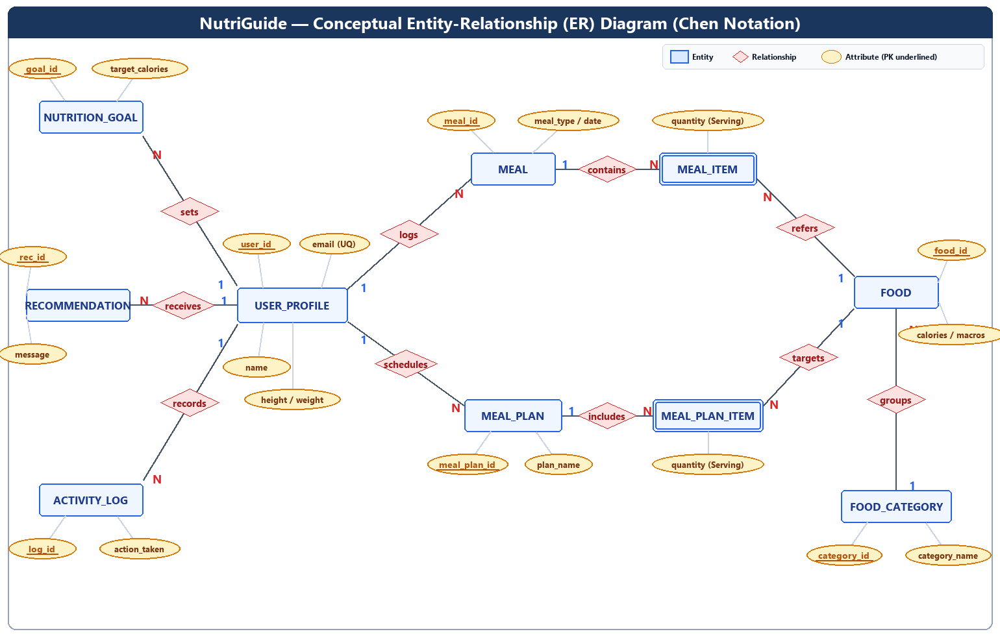
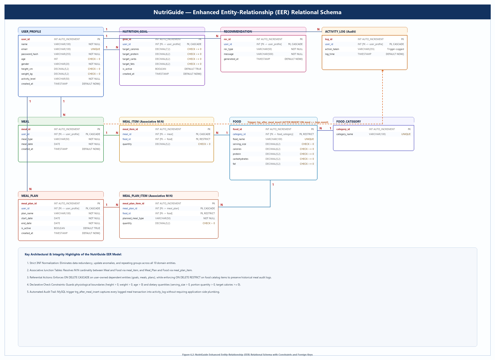
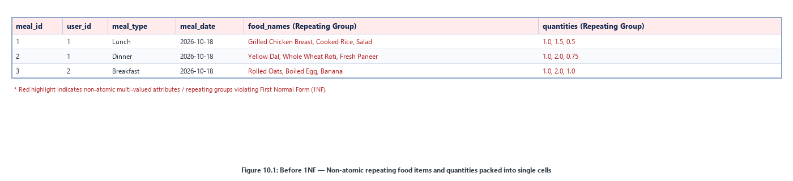
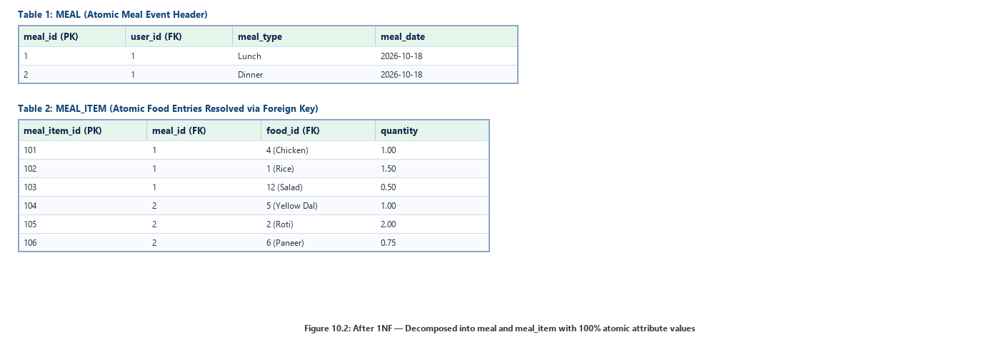
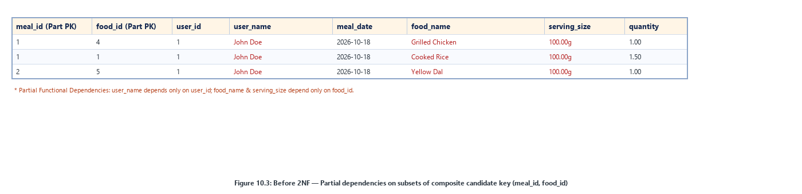
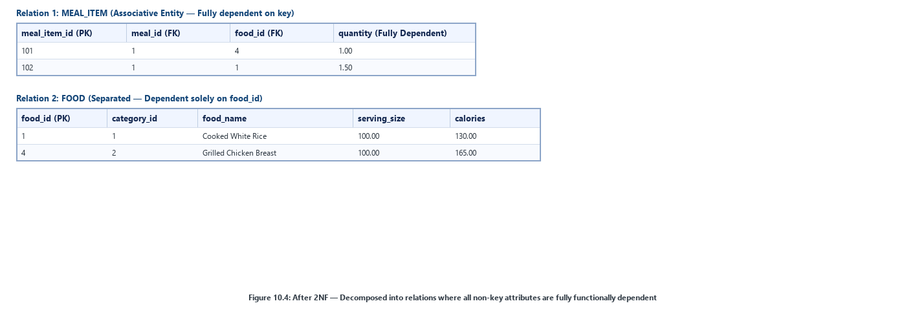
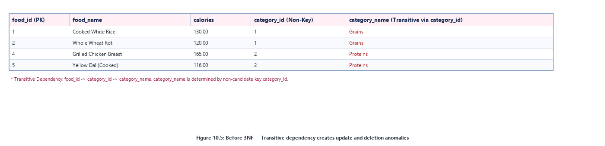
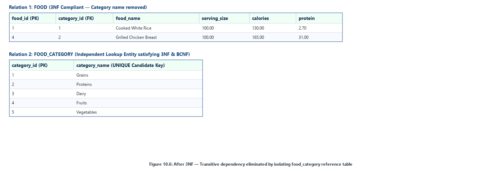

# SYMBIOSIS INTERNATIONAL (DEEMED UNIVERSITY)
### Department of Computer Science, Symbiosis Institute of Technology, Pune

---

# A DBMS MINI PROJECT REPORT ON
## **NutriGuide — Your Personal Nutrition Companion**


### **Batch: B3 | Group: GRP-1**

### **Submitted by:**
- **Tejas Jagdish Patil** (PRN: 26070122510)
- **Veer Parmar** (PRN: 26070122508)
- **Postiwala Vatsal Dipakbhai** (PRN: 26070122509)
- **Parth Bhayani** (PRN: 26070122512)

### **Under the Guidance of:**
**Dr. Balkrishna Patil**

**Department of Computer Science**  
**Symbiosis Institute of Technology (SIT), Pune**  
**Symbiosis International (Deemed University)**  
*Academic Year 2026–2027*

---

## INDEX

| Sr. No. | Title | Page No. |
|:---|:---|:---|
| 1. | **Introduction** | 2 |
| 2. | **Problem Statement (Step 1)** | 3 |
| 3. | **System Architecture and Modules** | 4 |
| 4. | **Functional and Non-Functional Requirements (Step 2)** | 5–6 |
| 5. | **Entities, Relationships and Attributes (Step 3)** | 7–8 |
| 6. | **ER and EER Diagrams (Step 4)** | 9–10 |
| 7. | **Relational Schema (Step 5)** | 11 |
| 8. | **Anomalies (Step 6)** | 12 |
| 9. | **Functional Dependencies (Step 7)** | 13–14 |
| 10. | **Normalization (Step 8: 1NF to BCNF)** | 15–17 |
| 11. | **Implementation of Tables in MySQL (Step 9)** | 18–22 |
| 12. | **Functions, Procedures, Triggers and Queries (Step 10)** | 23–30 |
| 13. | **Application of Codd's 12 Rules** | 31–32 |
| 14. | **Individual Contributions (Step 11)** | 33 |
| 15. | **Conclusion** | 34 |
| 16. | **References** | 35 |
| **App. A** | **Complete SQL Script (`NutriGuide.sql`)** | 35–36 |
| **App. B** | **Stored Functions, Procedures, Views & Triggers** | 37–38 |

---

## 1. Introduction

Keeping track of daily food intake and maintaining a healthy balance of nutrients is something many students and working adults struggle with every day. In our college campus and routine lives, most people either eat on erratic schedules or consume packed meals without knowing their actual caloric breakdown. When people attempt to track their diet, they typically jot down food names in spiral notebooks, smartphone note apps, or casual Excel sheets. In practice, this manual record-keeping quickly breaks down: scaling macro counts by hand whenever portion sizes change is tedious, food names get entered inconsistently, and the records end up scattered across months without any clear structure.

To tackle this real-world problem, our team designed and built **NutriGuide**, a desktop database application powered by a **Java Swing GUI**, an embedded **Java HTTP/REST service**, and a relational **MySQL 8.x** backend using the InnoDB storage engine. Developed as part of our Database Management Systems (DBMS) course, the core objective of this project is to take database theory taught in class and apply it directly to practical software development. We focused heavily on rigorous relational schema design—eliminating anomalies through normalization up to Boyce-Codd Normal Form (BCNF), preserving data integrity with explicit foreign key constraints (`CASCADE` and `RESTRICT`), and using stored subprograms to offload calculations from client memory to the database engine.

Our database schema models ten interconnected entities covering the full lifecycle of personal nutrition management:
1. **User Accounts & Health Metrics**: Storing basic demographic facts (age, gender), physical parameters (height in cm, weight in kg), and physical activity levels along with securely hashed credentials.
2. **Nutritional Targets & Goals**: Storing daily targets for calories, protein, carbohydrates, and fats, with active-flag versioning so users can adjust targets over time without erasing previous history.
3. **Food Item Catalog**: A catalog of foods organized into dietary categories (Grains, Proteins, Dairy, Fruits, Vegetables), complete with reference calories and macronutrient densities per standard 100g serving.
4. **Multi-Item Meal Logs**: Real-time logging of breakfast, lunch, dinner, and snack events, decomposed cleanly into individual food line items via the associative junction entity `meal_item`.
5. **Prospective Meal Regimens**: Allowing users to plan upcoming daily and weekly diets in advance across defined date windows.
6. **Dietary Recommendations**: Persisted automated guidelines that compare user goals against real consumed intake to identify caloric surpluses, deficits, and protein shortfalls.
7. **Database Audit Logging**: An automated audit trail written by database triggers on meal insertion, ensuring full accountability without requiring extra lines of application code.

The backend implementation relies on MySQL 8.x features including primary keys, candidate key uniqueness (`UNIQUE`), foreign keys with explicit cascade/restrict rules, and declarative `CHECK` constraints to ensure bad data never enters the tables. Above the basic tables, we implemented stored functions (dynamic BMI calculation), stored procedures with output parameters for daily summaries, database views for instant aggregations, and triggers for automated validation and auditing.

---

## 2. Problem Statement (Step 1)

When people try to record and track their nutrition by hand or via loose digital spreadsheets, they repeatedly run into practical data management hurdles:

1. **Scattered and Disorganized Information**: People tend to note daily meals in one place, body weight measurements in another, and their fitness goals on random sheets of paper. Because there is no central database linking these pieces together, analyzing changes in body weight against actual caloric intake over time becomes nearly impossible.
2. **Repetitive Calculation Errors**: Calculating daily totals of calories, proteins, carbs, and fats requires multiplying portion sizes by nutrient percentages for every single item on a plate. Performing these calculations manually every day leads to frequent arithmetic errors, giving users a false impression of what they actually consumed.
3. **Data Redundancy in Flat Files**: When food intake is saved in simple spreadsheets, common food items (like Boiled Eggs or Cooked White Rice) get their full nutrient facts re-typed for every logged meal. If someone discovers an error in the nutrient values and updates one row, all historical rows still hold the old value, creating conflicting and untrustworthy records.
4. **No Input Validation**: Spreadsheets and text notes do not stop users from typing invalid or nonsensical numbers, such as negative weights, zero heights, or negative portion sizes.
5. **Lack of Transaction Atomicity**: In reality, a meal consists of several food items eaten together. If an application crashes halfway through saving a multi-item meal, a manual or poorly designed system leaves orphaned records where a meal is recorded without its food items.
6. **Missing Audit History**: Traditional spreadsheets do not track when a record was logged, updated, or removed, making it impossible to audit past changes or identify user activity history.
7. **Disconnected Goal Comparison**: Without relational queries linking logged meals to active nutritional targets, users cannot easily know whether they hit their daily caloric surplus or deficit.

### Proposed Solution
NutriGuide directly resolves these flaws by implementing a centralized, fully normalized relational database in MySQL. The relational design eliminates redundant data, enforces strict primary and foreign key rules, validates inputs at the storage engine level with `CHECK` constraints, automatically computes daily metrics using stored procedures and views, and safeguards meal logging through atomic database transactions.

---

## 3. System Architecture and Modules

### 3.1 Three-Tier Relational Topology
To keep the application modular, maintainable, and easy to debug, we separated NutriGuide into three distinct architectural tiers:

1. **Presentation Layer (Java Swing Client)**: A desktop interface built using standard Java Swing components. It contains dedicated windows for user workflows (`LoginFrame`, `RegisterFrame`, `DashboardFrame`, `MealLogFrame`, `NutritionGoalFrame`, `RecommendationFrame`, `ReportFrame`, and `ProfileFrame`). To make sure the GUI never freezes while waiting for network or database responses, all HTTP requests run asynchronously in the background using `SwingWorker` threads, keeping the Event Dispatch Thread (EDT) responsive.
2. **Application & Logic Layer (Java HttpServer)**: A lightweight REST server running locally on `http://127.0.0.1:8081`. It handles route dispatching, input validation, and business logic across service classes (`AuthenticationService`, `NutritionService`, `MealService`, `FoodService`, `RecommendationService`, `ReportService`, and `UserService`). It manages user sessions through token authentication and protects user passwords using salted PBKDF2-HMAC-SHA256 with 600,000 hash iterations before communicating with MySQL over JDBC.
3. **Relational Database Layer (MySQL 8.x Engine)**: The core storage tier runs on MySQL 8.x using the InnoDB engine. It provides ACID transactional safety, enforces relational integrity (`CASCADE` / `RESTRICT`), executes stored functions and procedures, maintains aggregation views, and automatically invokes audit triggers.


*Figure 3.1: NutriGuide System Architecture & Multi-Tier Topology*

### 3.2 System Modules

1. **User Profile & Authentication Module (`user_profile`)**:
   - Handles account registration, login verification, and demographic tracking.
   - Stores user height, weight, age, gender, and physical activity level.
   - Keeps passwords secure using salted PBKDF2-HMAC-SHA256 hashing so plaintext passwords are never saved.
2. **Nutrition Goal Management Module (`nutrition_goal`)**:
   - Lets users configure target daily calories, protein, carbohydrate, and fat amounts.
   - Supports historical tracking by marking older goals inactive (`is_active = FALSE`) whenever a new goal is set.
   - Enforces the business rule that each user has exactly one active goal at any given time.
3. **Food Catalog & Categorization Module (`food_category`, `food`)**:
   - Stores a standardized catalog of foods organized into primary groups (Grains, Proteins, Dairy, Fruits, Vegetables).
   - Keeps track of serving sizes in grams along with calories and macronutrient densities.
4. **Meal Logging & Transaction Module (`meal`, `meal_item`)**:
   - Records breakfast, lunch, dinner, and snack entries for authenticated users.
   - Uses the associative junction table `meal_item` to link meals with multiple foods and their consumed portion multipliers.
   - Executes meal insertion inside atomic database transactions (`START TRANSACTION` / `COMMIT`).
5. **Meal Planning Module (`meal_plan`, `meal_plan_item`)**:
   - Enables users to prepare upcoming diet schedules across date intervals (e.g., a 7-day cutting plan).
   - Links planned meal times with food catalog items.
6. **Rule-Based Recommendation Engine (`recommendation`)**:
   - Compares active user goals with actual aggregate food intake.
   - Generates educational guidance alerting users to caloric surpluses, deficits, or low protein intake.
7. **Audit & Activity Log Module (`activity_log`)**:
   - Maintains an append-only log of user actions and trigger-captured meal events.
8. **Reporting & Analytics Module (`views`, `procedures`)**:
   - Utilizes views (`daily_nutrition_summary`) and stored procedures (`get_daily_summary`) to deliver aggregated intake reports without writing repetitive SQL queries in the frontend.

---

## 4. Functional and Non-Functional Requirements (Step 2)

### 4.1 Functional Requirements

| Requirement ID | Functional Description | Implemented Database Object |
|:---|:---|:---|
| **FR1** | Store and retrieve user profiles including height, weight, age, gender, and activity level. | Table `user_profile` |
| **FR2** | Securely hash user passwords using salted PBKDF2 with 600,000 iterations; prevent plaintext leakage. | Table `user_profile.password_hash`, `PasswordUtil.java` |
| **FR3** | Enforce global uniqueness of user email addresses to prevent duplicate registrations. | Constraint `UNIQUE KEY uq_user_email` on `user_profile` |
| **FR4** | Maintain food categories to systematically classify nutritional catalog items. | Table `food_category` |
| **FR5** | Store verified food items with per-serving caloric, protein, carbohydrate, and fat densities. | Table `food` (FK `category_id`) |
| **FR6** | Enforce uniqueness of food names to avoid duplicate food item creation. | Constraint `UNIQUE KEY uq_food_name` on `food` |
| **FR7** | Prevent physical deletion of food items referenced in past meal records to preserve historical integrity. | Referential Action `ON DELETE RESTRICT` on `meal_item.food_id` |
| **FR8** | Allow users to establish macronutrient and caloric target goals with historical archiving. | Table `nutrition_goal` |
| **FR9** | Enforce that only one nutrition goal is active (`is_active = TRUE`) per user account. | Service Layer Transaction & Table `nutrition_goal` |
| **FR10** | Record meal events linked to an authenticated user with meal type and date. | Table `meal` (FK `user_id`) |
| **FR11** | Atomically record multi-item meal lines linked to a parent meal and food catalog item. | Table `meal_item` (Composite/Surrogate PK, FKs) |
| **FR12** | Automatically log meal insertion events into the audit log without application intervention. | Trigger `trg_after_meal_insert` on `meal` |
| **FR13** | Reject invalid or non-positive food serving quantities at the database engine level. | Trigger `trg_validate_meal_quantity` (SIGNAL '45000') |
| **FR14** | Automatically compute user Body Mass Index (BMI) dynamically via a stored database function. | Stored Function `calculate_bmi(weight_kg, height_cm)` |
| **FR15** | Provide instantaneous multi-table aggregated daily nutritional intake totals. | Relational View `daily_nutrition_summary` |
| **FR16** | Return consolidated daily macro totals via stored procedure with output parameters. | Stored Procedure `get_daily_summary(...)` |
| **FR17** | Store prospective multi-day diet plans and their component planned meal items. | Tables `meal_plan`, `meal_plan_item` |
| **FR18** | Automatically clean up all dependent records (goals, meals, plans, logs) upon user profile deletion. | Referential Action `ON DELETE CASCADE` across foreign keys |

### 4.2 Non-Functional Requirements

- **Data Integrity & Consistency**: All relations enforce primary keys, explicit foreign key cascade and restrict policies, and declarative `CHECK` constraints to reject negative heights, weights, or serving sizes.
- **ACID Transaction Safety**: Meal logging and goal updates must execute atomically using database transactions; if any line item fails to save, all changes roll back to prevent half-saved meals.
- **Numeric Precision**: All nutritional numbers and portion multipliers use exact fixed-point `DECIMAL` types rather than `FLOAT` or `DOUBLE` to avoid cumulative IEEE 754 rounding discrepancies.
- **Database Security**: The database listens only on local loopback (`127.0.0.1`); all backend SQL queries use parameterized `PreparedStatement` calls to prevent SQL injection.
- **Cohesion & Normalization**: The database tables are normalized up to 3NF and BCNF, ensuring every table represents exactly one clear real-world concept.

---

## 5. Entities, Relationships and Attributes (Step 3)

### 5.1 Entities and Attributes

| Entity / Table Name | Primary Key | Foreign Keys | Key Attributes | Business Purpose |
|:---|:---|:---|:---|:---|
| **`user_profile`** | `user_id` | *None* | `name`, `email`, `password_hash`, `age`, `gender`, `height_cm`, `weight_kg`, `activity_level`, `created_at` | Stores user account information, demographic facts, and physical measurements. |
| **`nutrition_goal`** | `goal_id` | `user_id` | `target_calories`, `target_protein`, `target_carbs`, `target_fats`, `is_active`, `created_at` | Tracks daily calorie and macronutrient targets configured by users. |
| **`food_category`** | `category_id` | *None* | `category_name` | Organizes food catalog items into standard dietary groups. |
| **`food`** | `food_id` | `category_id` | `food_name`, `serving_size`, `calories`, `protein`, `carbohydrates`, `fat` | Contains nutritional facts per standard serving for catalog food items. |
| **`meal`** | `meal_id` | `user_id` | `meal_type`, `meal_date`, `created_at` | Represents a meal event consumed by a user on a given day. |
| **`meal_item`** | `meal_item_id` | `meal_id`, `food_id` | `quantity` | Associative junction resolving the M:N relationship between meals and foods. |
| **`meal_plan`** | `meal_plan_id` | `user_id` | `plan_name`, `start_date`, `end_date`, `is_active`, `created_at` | Prospective diet schedules created for specific date ranges. |
| **`meal_plan_item`** | `meal_plan_item_id` | `meal_plan_id`, `food_id` | `planned_meal_type`, `quantity` | Associative junction resolving the M:N relationship between diet plans and foods. |
| **`recommendation`** | `rec_id` | `user_id` | `rec_type`, `message`, `generated_at` | Stores automated dietary feedback comparing intake with target goals. |
| **`activity_log`** | `log_id` | `user_id` | `action_taken`, `log_time` | Audit trail recording user account actions and meal insertions. |

### 5.2 Relationships and Cardinalities

| Relationship | Entity 1 | Entity 2 | Cardinality | Participation | Description |
|:---|:---|:---|:---|:---|:---|
| **User_Sets_Goals** | `user_profile` | `nutrition_goal` | **1 : N** | User: Partial<br>Goal: Total | One user can have multiple historical goals, but each goal belongs to one user. |
| **User_Logs_Meals** | `user_profile` | `meal` | **1 : N** | User: Partial<br>Meal: Total | A user logs multiple meals over time; each meal belongs to one specific user. |
| **Meal_Contains_Items** | `meal` | `meal_item` | **1 : N** | Meal: Total<br>Item: Total | A meal contains one or more food items; each item links to one parent meal. |
| **Food_Appears_In_Items**| `food` | `meal_item` | **1 : N** | Food: Partial<br>Item: Total | A food can be chosen in many meal items; each line item references one food. |
| **Category_Classifies_Food**| `food_category` | `food` | **1 : N** | Category: Partial<br>Food: Total | A category groups multiple foods; each food belongs to exactly one category. |
| **User_Schedules_Plans** | `user_profile` | `meal_plan` | **1 : N** | User: Partial<br>Plan: Total | A user can create several planned diet schedules over time. |
| **Plan_Includes_Items** | `meal_plan` | `meal_plan_item`| **1 : N** | Plan: Total<br>Item: Total | A meal plan includes multiple scheduled food entries. |
| **Food_In_Meal_Plans** | `food` | `meal_plan_item`| **1 : N** | Food: Partial<br>Item: Total | A food item can appear across multiple diet plans. |
| **User_Receives_Recs** | `user_profile` | `recommendation`| **1 : N** | User: Partial<br>Rec: Total | A user receives multiple dietary recommendations as they log meals. |
| **User_Generates_Audit**| `user_profile` | `activity_log` | **1 : N** | User: Partial<br>Log: Total | User operations and meal triggers produce timestamped audit entries. |

#### Resolving Many-to-Many Relationships
- **Meal and Food (M:N)**: A meal contains multiple foods, and the same food can appear in hundreds of different meals across different days and users. We resolved this M:N relationship by creating the associative table **`meal_item`**, which stores `meal_id`, `food_id`, and the portion multiplier `quantity`.
- **Meal_Plan and Food (M:N)**: A planned diet regimen involves multiple foods, and a food can be scheduled in different plans. We resolved this M:N relationship with the associative table **`meal_plan_item`**.

---

## 6. ER and EER Diagrams (Step 4)

### 6.1 Conceptual ER Diagram (Chen Notation)
The Entity-Relationship (ER) diagram below presents the conceptual design of NutriGuide drawn according to standard Chen notation:
- **Rectangles**: Represent the ten entity sets in our database.
- **Diamonds**: Represent relationships connecting the entities.
- **Ellipses**: Represent attributes, with primary keys clearly underlined.
- **Numbers (1 and N)**: Indicate relationship cardinalities along connecting lines.


*Figure 6.1: NutriGuide Conceptual ER Diagram (Chen Notation) with M:N Associative Resolution*

### 6.2 Enhanced Entity-Relationship (EER) Diagram
The Enhanced ER (EER) diagram shows the physical implementation schema in MySQL:
- Table cards showing exact column data types, primary keys (`[PK]`), and foreign keys (`[FK]`).
- Explicit foreign key referential actions (`ON DELETE CASCADE` and `ON DELETE RESTRICT`).
- Declarative `CHECK` constraints guarding physical boundaries (height > 0, weight > 0, quantity > 0).
- The automated trigger flow connecting `meal` to `activity_log` via `trg_after_meal_insert`.


*Figure 6.2: NutriGuide Enhanced Entity-Relationship (EER) Relational Schema with Constraints and Foreign Keys*


---

## 7. Relational Schema (Step 5)

### 7.1 Relational Notation
*(Underlined: Primary Key | Italic: Foreign Key)*

1. **`user_profile`** (<u>user_id</u>, name, email, password_hash, age, gender, height_cm, weight_kg, activity_level, created_at)
2. **`nutrition_goal`** (<u>goal_id</u>, *user_id*, target_calories, target_protein, target_carbs, target_fats, is_active, created_at)
3. **`food_category`** (<u>category_id</u>, category_name)
4. **`food`** (<u>food_id</u>, *category_id*, food_name, serving_size, calories, protein, carbohydrates, fat)
5. **`meal`** (<u>meal_id</u>, *user_id*, meal_type, meal_date, created_at)
6. **`meal_item`** (<u>meal_item_id</u>, *meal_id*, *food_id*, quantity)
7. **`meal_plan`** (<u>meal_plan_id</u>, *user_id*, plan_name, start_date, end_date, is_active, created_at)
8. **`meal_plan_item`** (<u>meal_plan_item_id</u>, *meal_plan_id*, *food_id*, planned_meal_type, quantity)
9. **`recommendation`** (<u>rec_id</u>, *user_id*, rec_type, message, generated_at)
10. **`activity_log`** (<u>log_id</u>, *user_id*, action_taken, log_time)

### 7.2 Foreign Keys and Referential Integrity Rules

When setting up foreign key constraints in MySQL, our team thought carefully about real-world scenarios. We needed to distinguish between user-owned records (which should be deleted if the user leaves) and reference catalog data (which must never be deleted if historical logs depend on it).

| Foreign Key | Child Table | Parent Table & Referenced Column | ON UPDATE | ON DELETE | Engineering Rationale |
|:---|:---|:---|:---|:---|:---|
| `fk_nutrition_goal_user` | `nutrition_goal` | `user_profile(user_id)` | `CASCADE` | `CASCADE` | When a user profile is removed, all their personal nutrition goals are purged. |
| `fk_food_category` | `food` | `food_category(category_id)` | `CASCADE` | `RESTRICT` | Stops anyone from accidentally deleting a food category while active foods belong to it. |
| `fk_meal_user` | `meal` | `user_profile(user_id)` | `CASCADE` | `CASCADE` | Deleting a user account cleans up all meal records logged by that user. |
| `fk_meal_item_meal` | `meal_item` | `meal(meal_id)` | `CASCADE` | `CASCADE` | Removing a meal header automatically removes all individual food items in that meal. |
| `fk_meal_item_food` | `meal_item` | `food(food_id)` | `CASCADE` | `RESTRICT` | Protects past meal history: a food item cannot be dropped if someone has logged it before. |
| `fk_meal_plan_user` | `meal_plan` | `user_profile(user_id)` | `CASCADE` | `CASCADE` | Deleting a user cleans up all upcoming meal plans created by that user. |
| `fk_meal_plan_item_plan` | `meal_plan_item` | `meal_plan(meal_plan_id)` | `CASCADE` | `CASCADE` | Deleting a meal plan automatically removes all scheduled food line items in it. |
| `fk_meal_plan_item_food` | `meal_plan_item` | `food(food_id)` | `CASCADE` | `RESTRICT` | Prevents removing a catalog food if it is currently scheduled in an active diet plan. |
| `fk_recommendation_user` | `recommendation` | `user_profile(user_id)` | `CASCADE` | `CASCADE` | Removing a user account clears out their past recommendation history. |
| `fk_activity_log_user` | `activity_log` | `user_profile(user_id)` | `CASCADE` | `CASCADE` | Account termination cascades to clean up the user's audit log entries. |

---

## 8. Anomalies (Step 6)

In relational database theory, an anomaly is a data integrity flaw that happens when unrelated entities are jammed into a single table. To see why NutriGuide must be broken down into normalized tables, we created a sample flat relation called `NUTRITION_FLAT`. This mirrors how a typical beginner would store data in a single spreadsheet tab:

#### Unnormalized Relation: `NUTRITION_FLAT`
*(Composite Candidate Key: `{email, meal_date, meal_type, food_name}`)*

| user_id | name | email | height_cm | weight_kg | meal_date | meal_type | food_name | serving_size | calories | protein | category_name | quantity |
|:---|:---|:---|:---|:---|:---|:---|:---|:---|:---|:---|:---|:---|
| 1 | John Doe | user@example.com | 175.00 | 70.00 | 2026-10-18 | Lunch | Grilled Chicken | 100.00 | 165.00 | 31.00 | Proteins | 1.00 |
| 1 | John Doe | user@example.com | 175.00 | 70.00 | 2026-10-18 | Lunch | Cooked White Rice | 100.00 | 130.00 | 2.70 | Grains | 1.50 |
| 1 | John Doe | user@example.com | 175.00 | 70.00 | 2026-10-18 | Dinner | Yellow Dal | 100.00 | 116.00 | 7.30 | Proteins | 1.00 |
| 2 | Jane Smith | jane@example.com | 162.00 | 58.00 | 2026-10-18 | Breakfast| Rolled Oats | 100.00 | 389.00 | 16.90 | Grains | 1.00 |

Examining this flat table reveals three fundamental anomalies:

### 8.1 Insertion Anomalies
1. **Adding New Foods Without a Meal**: Suppose an administrator wants to add a new food item like *Broccoli* to the catalog. In `NUTRITION_FLAT`, this is impossible because the candidate key requires `email`, `meal_date`, and `meal_type`. Since primary key columns cannot be `NULL`, the food cannot be inserted until someone eats it.
2. **Registering a New User Without Logging a Meal**: When a new user registers on the app, their account cannot be saved in `NUTRITION_FLAT` until they log their first meal, because food columns cannot be empty.
3. **Creating Empty Food Categories**: An administrator cannot create a new category (e.g., *Beverages*) until a user, a meal, and a food in that category are all entered together.

### 8.2 Update Anomalies
1. **Redundant Profile Updates**: If John Doe updates his body weight from 70.00 kg to 68.50 kg, the update has to be executed on every single row he has ever logged in the past. If a query updates only recent rows, John will end up with two different weights in the same table.
2. **Food Nutrient Changes**: If the nutritional content of *Cooked White Rice* is corrected, every single historical meal referencing white rice has to be modified. A partial update leaves contradictory nutrient facts in the system.
3. **Renaming Categories**: Renaming *Proteins* to *Protein Sources* requires searching and updating thousands of meal rows, risking typos and inconsistent data.

### 8.3 Deletion Anomalies
1. **Losing User Information on Meal Deletion**: If John Doe logs only one meal and later decides to delete that meal record, deleting the row wipes out his user account, password hash, height, and weight as well.
2. **Losing Catalog Items on History Cleanup**: If Jane Smith is the only person who logged *Rolled Oats* and she deletes her meal log, the entire nutritional profile of *Rolled Oats* and its category are permanently lost from the database.

---

## 9. Functional Dependencies (Step 7)

A functional dependency $X \rightarrow Y$ means that whenever two rows have the same value for column set $X$, they must also have the identical value for column set $Y$. 

Our schema is governed by the following formal functional dependencies and candidate keys:

### 1. `user_profile`
- **Candidate Keys**: `{user_id}`, `{email}`
- **Primary Key**: `user_id`
- **Functional Dependencies**:
  - user_id → name, email, password_hash, age, gender, height_cm, weight_kg, activity_level, created_at
  - email → user_id, name, password_hash, age, gender, height_cm, weight_kg, activity_level, created_at
  - *Explanation*: Each user is uniquely identified by their auto-incremented `user_id`. Since `email` is enforced with a `UNIQUE` constraint, it also uniquely identifies all remaining user attributes.

### 2. `nutrition_goal`
- **Candidate Key**: `{goal_id}`
- **Primary Key**: `goal_id`
- **Functional Dependencies**:
  - goal_id → user_id, target_calories, target_protein, target_carbs, target_fats, is_active, created_at
  - *Explanation*: Every nutrition goal is uniquely identified by its primary key `goal_id`.

### 3. `food_category`
- **Candidate Keys**: `{category_id}`, `{category_name}`
- **Primary Key**: `category_id`
- **Functional Dependencies**:
  - category_id → category_name
  - category_name → category_id
  - *Explanation*: Dietary categories are uniquely identified by both their numeric ID and their unique category name.

### 4. `food`
- **Candidate Keys**: `{food_id}`, `{food_name}`
- **Primary Key**: `food_id`
- **Functional Dependencies**:
  - food_id → category_id, food_name, serving_size, calories, protein, carbohydrates, fat
  - food_name → food_id, category_id, serving_size, calories, protein, carbohydrates, fat
  - *Explanation*: Nutritional facts are fixed properties of a food item; knowing either `food_id` or unique `food_name` determines all nutritional facts.

### 5. `meal`
- **Candidate Key**: `{meal_id}`
- **Primary Key**: `meal_id`
- **Functional Dependencies**:
  - meal_id → user_id, meal_type, meal_date, created_at
  - *Explanation*: A meal event is uniquely identified by `meal_id`. Users can log multiple meals of the same type on the same date (e.g., two snacks).

### 6. `meal_item`
- **Candidate Keys**: `{meal_item_id}`, `{meal_id, food_id}`
- **Primary Key**: `meal_item_id`
- **Functional Dependencies**:
  - meal_item_id → meal_id, food_id, quantity
  - (meal_id, food_id) → meal_item_id, quantity
  - *Explanation*: Each meal item line references a specific food and portion quantity consumed within a parent meal event.

### 7. `meal_plan`
- **Candidate Key**: `{meal_plan_id}`
- **Primary Key**: `meal_plan_id`
- **Functional Dependencies**:
  - meal_plan_id → user_id, plan_name, start_date, end_date, is_active, created_at

### 8. `meal_plan_item`
- **Candidate Key**: `{meal_plan_item_id}`
- **Primary Key**: `meal_plan_item_id`
- **Functional Dependencies**:
  - meal_plan_item_id → meal_plan_id, food_id, planned_meal_type, quantity

### 9. `recommendation`
- **Candidate Key**: `{rec_id}`
- **Primary Key**: `rec_id`
- **Functional Dependencies**:
  - rec_id → user_id, rec_type, message, generated_at

### 10. `activity_log`
- **Candidate Key**: `{log_id}`
- **Primary Key**: `log_id`
- **Functional Dependencies**:
  - log_id → user_id, action_taken, log_time

---

## 10. Normalization (Step 8: 1NF to BCNF)

Normalization is the systematic process of decomposing large, unnormalized relations into smaller, well-structured tables to eliminate redundancy and prevent anomalies. During the design of NutriGuide, our group walked through the normalization stages from unnormalized flat data up to Boyce-Codd Normal Form (BCNF).

### 10.1 First Normal Form (1NF)
**Rule**: A relation is in 1NF if every column contains only atomic (indivisible) values, and there are no repeating groups or comma-separated lists inside a single cell.

- **Violation in Unnormalized Data**: In the raw flat spreadsheet, multiple foods and their quantities were lumped together as comma-separated text strings within single cells (for instance, `"Grilled Chicken, Cooked Rice"` and `"1.0, 1.5"`).


*Figure 10.1: Before 1NF — Multi-valued repeating groups packed into single cells*

- **1NF Decomposition**: We eliminated repeating groups by splitting the data so that every cell stores exactly one value. The parent meal event is separated into `meal`, while each food consumed is stored as an individual row in `meal_item`.


*Figure 10.2: After 1NF — Decomposed into meal and meal_item with strictly atomic attributes*

---

### 10.2 Second Normal Form (2NF)
**Rule**: A relation is in 2NF if it is already in 1NF and every non-key column is **fully functionally dependent** on the entire primary key. In other words, there must be no partial dependencies where an attribute depends on only part of a composite primary key.

- **Violation in 1NF Composite Table**: If we look at an associative table using `(meal_id, food_id)` as the composite key alongside user attributes and food nutritional values:
  - (meal_id, food_id) → quantity (Full dependency on the whole composite key)
  - food_id → food_name, serving_size, calories, protein (Partial dependency on just food_id)
  - meal_id → user_id, meal_date (Partial dependency on just meal_id)


*Figure 10.3: Before 2NF — Partial dependencies on proper subsets of composite candidate key*

- **2NF Decomposition**: We extracted partially dependent attributes into separate tables:
  1. `food` stores attributes that depend solely on `food_id`.
  2. `meal` stores attributes that depend solely on `meal_id`.
  3. `meal_item` keeps only `quantity`, which genuinely depends on the pair `(meal_id, food_id)`.


*Figure 10.4: After 2NF — Decomposed into relations where all non-key attributes are fully dependent on the primary key*

---

### 10.3 Third Normal Form (3NF)
**Rule**: A relation is in 3NF if it is in 2NF and has **no transitive dependencies**. A transitive dependency occurs when non-key attribute A determines non-key attribute B (i.e., $X \rightarrow Y$ and $Y \rightarrow Z$, where $Y$ is not a candidate key).

- **Violation in 2NF Food Table**: In the food table before 3NF, the category name was stored directly alongside the category ID:
  - food_id → category_id
  - category_id → category_name
  - This created a transitive dependency: `food_id → category_name` via `category_id`.


*Figure 10.5: Before 3NF — Transitive dependency creates update and deletion anomalies*

- **3NF Decomposition**: We removed this transitive dependency by separating `food_category` into its own table (`category_id`, `category_name`). The `food` table now keeps only `category_id` as a foreign key.


*Figure 10.6: After 3NF — Transitive dependency eliminated by isolating food_category lookup entity*

---

### 10.4 Boyce-Codd Normal Form (BCNF)
**Rule**: A relation is in BCNF if for every non-trivial functional dependency $X \rightarrow Y$, the determinant $X$ is a **superkey** (candidate key).

#### BCNF Verification for NutriGuide Relations:
- In `user_profile`: Determinants are `user_id` and `email`. Both are candidate keys. ✓
- In `food`: Determinants are `food_id` and `food_name`. Both are candidate keys. ✓
- In `food_category`: Determinants are `category_id` and `category_name`. Both are candidate keys. ✓
- In `nutrition_goal`, `meal`, `meal_item`, `meal_plan`, `meal_plan_item`, `recommendation`, and `activity_log`: Every determinant is a primary key or candidate key. ✓

**Result**: All ten tables in our schema strictly satisfy **Boyce-Codd Normal Form (BCNF)**.

### 10.5 Decomposition Summary

| Original Flat Concept | Normalized 3NF/BCNF Relations | Primary Keys | Foreign Keys |
|:---|:---|:---|:---|
| User Profile & Demographics | `user_profile` | `user_id` | *None* |
| Daily Target Goals | `nutrition_goal` | `goal_id` | `user_id` |
| Dietary Categories | `food_category` | `category_id` | *None* |
| Food Nutrient Catalog | `food` | `food_id` | `category_id` |
| Meal Events Header | `meal` | `meal_id` | `user_id` |
| Multi-Item Meal Lines | `meal_item` | `meal_item_id` | `meal_id`, `food_id` |
| Scheduled Diet Plans | `meal_plan` | `meal_plan_id` | `user_id` |
| Diet Plan Meal Lines | `meal_plan_item` | `meal_plan_item_id` | `meal_plan_id`, `food_id` |
| Nutritional Feedback | `recommendation` | `rec_id` | `user_id` |
| Activity Audit Log | `activity_log` | `log_id` | `user_id` |

### 10.6 Lossless Join Verification
To verify that our normalization process was strictly **lossless** (meaning we can join the normalized tables back together without creating fake tuples or losing real data), we run the following multi-table SQL query:

```sql
SELECT 
    u.name AS user_name,
    m.meal_date,
    m.meal_type,
    f.food_name,
    c.category_name,
    mi.quantity,
    ROUND(f.calories * mi.quantity, 2) AS total_calories,
    ROUND(f.protein * mi.quantity, 2) AS total_protein
FROM meal m
JOIN user_profile u ON m.user_id = u.user_id
JOIN meal_item mi ON m.meal_id = mi.meal_id
JOIN food f ON mi.food_id = f.food_id
JOIN food_category c ON f.category_id = c.category_id
WHERE u.user_id = 1
ORDER BY m.meal_date, m.meal_id, mi.meal_item_id;
```

#### Lossless Join Output:
| user_name | meal_date | meal_type | food_name | category_name | quantity | total_calories | total_protein |
|:---|:---|:---|:---|:---|:---|:---|:---|
| John Doe | 2026-10-18 | Lunch | Grilled Chicken Breast | Proteins | 1.00 | 165.00 | 31.00 |
| John Doe | 2026-10-18 | Lunch | Cooked White Rice | Grains | 1.50 | 195.00 | 4.05 |
| John Doe | 2026-10-18 | Dinner | Yellow Dal (Cooked) | Proteins | 1.00 | 116.00 | 7.30 |
| John Doe | 2026-10-18 | Dinner | Whole Wheat Roti | Grains | 2.00 | 240.00 | 7.00 |


---

## 11. Implementation of Tables in MySQL (Step 9)

We implemented the NutriGuide database in **MySQL 8.x** using the default **InnoDB** storage engine. We selected InnoDB specifically because our multi-item meal logging requires strict ACID transaction support, row-level locking, and foreign key enforcement. All table constraints—including primary keys, foreign keys, unique email rules, and positive-value `CHECK` constraints—are enforced directly by the database engine.

### 11.1 Table DDL Definitions

```sql
CREATE DATABASE IF NOT EXISTS nutriguide;
USE nutriguide;

-- 1. USER_PROFILE
CREATE TABLE IF NOT EXISTS user_profile (
    user_id INT AUTO_INCREMENT PRIMARY KEY,
    name VARCHAR(100) NOT NULL,
    email VARCHAR(100) NOT NULL UNIQUE,
    password_hash VARCHAR(255) NOT NULL,
    age INT NOT NULL CHECK (age > 0),
    gender VARCHAR(20) NOT NULL,
    height_cm DECIMAL(5, 2) NOT NULL CHECK (height_cm > 0),
    weight_kg DECIMAL(5, 2) NOT NULL CHECK (weight_kg > 0),
    activity_level VARCHAR(50) NOT NULL,
    created_at TIMESTAMP DEFAULT CURRENT_TIMESTAMP
) ENGINE=InnoDB;

-- 2. NUTRITION_GOAL
CREATE TABLE IF NOT EXISTS nutrition_goal (
    goal_id INT AUTO_INCREMENT PRIMARY KEY,
    user_id INT NOT NULL,
    target_calories DECIMAL(7, 2) NOT NULL CHECK (target_calories >= 0),
    target_protein DECIMAL(6, 2) NOT NULL CHECK (target_protein >= 0),
    target_carbs DECIMAL(6, 2) NOT NULL CHECK (target_carbs >= 0),
    target_fats DECIMAL(6, 2) NOT NULL CHECK (target_fats >= 0),
    is_active BOOLEAN DEFAULT TRUE,
    created_at TIMESTAMP DEFAULT CURRENT_TIMESTAMP,
    CONSTRAINT fk_nutrition_goal_user FOREIGN KEY (user_id)
        REFERENCES user_profile (user_id)
        ON DELETE CASCADE ON UPDATE CASCADE
) ENGINE=InnoDB;

-- 3. FOOD_CATEGORY
CREATE TABLE IF NOT EXISTS food_category (
    category_id INT AUTO_INCREMENT PRIMARY KEY,
    category_name VARCHAR(100) NOT NULL UNIQUE
) ENGINE=InnoDB;

-- 4. FOOD
CREATE TABLE IF NOT EXISTS food (
    food_id INT AUTO_INCREMENT PRIMARY KEY,
    category_id INT NOT NULL,
    food_name VARCHAR(100) NOT NULL UNIQUE,
    serving_size DECIMAL(6, 2) NOT NULL CHECK (serving_size > 0),
    calories DECIMAL(6, 2) NOT NULL CHECK (calories >= 0),
    protein DECIMAL(5, 2) NOT NULL CHECK (protein >= 0),
    carbohydrates DECIMAL(5, 2) NOT NULL CHECK (carbohydrates >= 0),
    fat DECIMAL(5, 2) NOT NULL CHECK (fat >= 0),
    CONSTRAINT fk_food_category FOREIGN KEY (category_id)
        REFERENCES food_category (category_id)
        ON DELETE RESTRICT ON UPDATE CASCADE
) ENGINE=InnoDB;

-- 5. MEAL
CREATE TABLE IF NOT EXISTS meal (
    meal_id INT AUTO_INCREMENT PRIMARY KEY,
    user_id INT NOT NULL,
    meal_type VARCHAR(50) NOT NULL,
    meal_date DATE NOT NULL,
    created_at TIMESTAMP DEFAULT CURRENT_TIMESTAMP,
    CONSTRAINT fk_meal_user FOREIGN KEY (user_id)
        REFERENCES user_profile (user_id)
        ON DELETE CASCADE ON UPDATE CASCADE
) ENGINE=InnoDB;

-- 6. MEAL_ITEM
CREATE TABLE IF NOT EXISTS meal_item (
    meal_item_id INT AUTO_INCREMENT PRIMARY KEY,
    meal_id INT NOT NULL,
    food_id INT NOT NULL,
    quantity DECIMAL(5, 2) NOT NULL CHECK (quantity > 0),
    CONSTRAINT fk_meal_item_meal FOREIGN KEY (meal_id)
        REFERENCES meal (meal_id)
        ON DELETE CASCADE ON UPDATE CASCADE,
    CONSTRAINT fk_meal_item_food FOREIGN KEY (food_id)
        REFERENCES food (food_id)
        ON DELETE RESTRICT ON UPDATE CASCADE
) ENGINE=InnoDB;

-- 7. MEAL_PLAN
CREATE TABLE IF NOT EXISTS meal_plan (
    meal_plan_id INT AUTO_INCREMENT PRIMARY KEY,
    user_id INT NOT NULL,
    plan_name VARCHAR(100) NOT NULL,
    start_date DATE NOT NULL,
    end_date DATE NOT NULL,
    is_active BOOLEAN DEFAULT TRUE,
    created_at TIMESTAMP DEFAULT CURRENT_TIMESTAMP,
    CONSTRAINT fk_meal_plan_user FOREIGN KEY (user_id)
        REFERENCES user_profile (user_id)
        ON DELETE CASCADE ON UPDATE CASCADE
) ENGINE=InnoDB;

-- 8. MEAL_PLAN_ITEM
CREATE TABLE IF NOT EXISTS meal_plan_item (
    meal_plan_item_id INT AUTO_INCREMENT PRIMARY KEY,
    meal_plan_id INT NOT NULL,
    food_id INT NOT NULL,
    planned_meal_type VARCHAR(50) NOT NULL,
    quantity DECIMAL(5, 2) NOT NULL CHECK (quantity > 0),
    CONSTRAINT fk_meal_plan_item_plan FOREIGN KEY (meal_plan_id)
        REFERENCES meal_plan (meal_plan_id)
        ON DELETE CASCADE ON UPDATE CASCADE,
    CONSTRAINT fk_meal_plan_item_food FOREIGN KEY (food_id)
        REFERENCES food (food_id)
        ON DELETE RESTRICT ON UPDATE CASCADE
) ENGINE=InnoDB;

-- 9. RECOMMENDATION
CREATE TABLE IF NOT EXISTS recommendation (
    rec_id INT AUTO_INCREMENT PRIMARY KEY,
    user_id INT NOT NULL,
    rec_type VARCHAR(50) NOT NULL,
    message VARCHAR(500) NOT NULL,
    generated_at TIMESTAMP DEFAULT CURRENT_TIMESTAMP,
    CONSTRAINT fk_recommendation_user FOREIGN KEY (user_id)
        REFERENCES user_profile (user_id)
        ON DELETE CASCADE ON UPDATE CASCADE
) ENGINE=InnoDB;

-- 10. ACTIVITY_LOG
CREATE TABLE IF NOT EXISTS activity_log (
    log_id INT AUTO_INCREMENT PRIMARY KEY,
    user_id INT NOT NULL,
    action_taken VARCHAR(255) NOT NULL,
    log_time TIMESTAMP DEFAULT CURRENT_TIMESTAMP,
    CONSTRAINT fk_activity_log_user FOREIGN KEY (user_id)
        REFERENCES user_profile (user_id)
        ON DELETE CASCADE ON UPDATE CASCADE
) ENGINE=InnoDB;
```

---

### 11.2 Record Count Verification Query
To verify that all 10 tables are created and seeded with baseline records:

```sql
SELECT 'user_profile' AS Table_Name, COUNT(*) AS Total_Records FROM user_profile
UNION ALL SELECT 'nutrition_goal', COUNT(*) FROM nutrition_goal
UNION ALL SELECT 'food_category', COUNT(*) FROM food_category
UNION ALL SELECT 'food', COUNT(*) FROM food
UNION ALL SELECT 'meal', COUNT(*) FROM meal
UNION ALL SELECT 'meal_item', COUNT(*) FROM meal_item
UNION ALL SELECT 'meal_plan', COUNT(*) FROM meal_plan
UNION ALL SELECT 'meal_plan_item', COUNT(*) FROM meal_plan_item
UNION ALL SELECT 'recommendation', COUNT(*) FROM recommendation
UNION ALL SELECT 'activity_log', COUNT(*) FROM activity_log;
```

#### Output:
| Table_Name | Total_Records |
|:---|:---|
| `user_profile` | 2 |
| `nutrition_goal` | 2 |
| `food_category` | 5 |
| `food` | 15 |
| `meal` | 4 |
| `meal_item` | 8 |
| `meal_plan` | 1 |
| `meal_plan_item` | 3 |
| `recommendation` | 2 |
| `activity_log` | 4 |

---

### 11.3 Table Contents After Loading Seed Data

#### 1. `SELECT * FROM food_category;`
| category_id | category_name |
|:---|:---|
| 1 | Grains |
| 2 | Proteins |
| 3 | Dairy |
| 4 | Fruits |
| 5 | Vegetables |

#### 2. `SELECT * FROM food;`
| food_id | category_id | food_name | serving_size | calories | protein | carbohydrates | fat |
|:---|:---|:---|:---|:---|:---|:---|:---|
| 1 | 1 | Cooked White Rice | 100.00 | 130.00 | 2.70 | 28.20 | 0.30 |
| 2 | 1 | Whole Wheat Roti | 50.00 | 120.00 | 3.50 | 22.00 | 2.00 |
| 3 | 1 | Rolled Oats | 100.00 | 389.00 | 16.90 | 66.30 | 6.90 |
| 4 | 2 | Grilled Chicken Breast | 100.00 | 165.00 | 31.00 | 0.00 | 3.60 |
| 5 | 2 | Yellow Dal (Cooked) | 100.00 | 116.00 | 7.30 | 20.00 | 1.20 |
| 6 | 2 | Fresh Paneer | 100.00 | 265.00 | 18.30 | 3.40 | 20.80 |
| 7 | 2 | Boiled Egg | 50.00 | 78.00 | 6.30 | 0.60 | 5.30 |
| 8 | 4 | Apple | 100.00 | 52.00 | 0.30 | 13.80 | 0.20 |
| 9 | 4 | Banana | 100.00 | 89.00 | 1.10 | 22.80 | 0.30 |
| 10 | 4 | Orange | 100.00 | 47.00 | 0.90 | 11.80 | 0.10 |
| 11 | 3 | Whole Milk | 100.00 | 61.00 | 3.20 | 4.80 | 3.30 |
| 12 | 3 | Greek Yogurt | 100.00 | 59.00 | 10.00 | 3.60 | 0.40 |
| 13 | 5 | Steamed Broccoli | 100.00 | 35.00 | 2.40 | 7.20 | 0.40 |
| 14 | 5 | Mixed Green Salad | 100.00 | 20.00 | 1.20 | 3.80 | 0.20 |
| 15 | 5 | Boiled Potato | 100.00 | 87.00 | 1.90 | 20.10 | 0.10 |

#### 3. `SELECT user_id, name, email, age, gender, height_cm, weight_kg, activity_level FROM user_profile;`
| user_id | name | email | age | gender | height_cm | weight_kg | activity_level |
|:---|:---|:---|:---|:---|:---|:---|:---|
| 1 | John Doe | user@example.com | 24 | Male | 175.00 | 70.00 | Moderately Active |
| 2 | Jane Smith | jane@example.com | 22 | Female | 162.00 | 58.00 | Lightly Active |

#### 4. `SELECT * FROM nutrition_goal;`
| goal_id | user_id | target_calories | target_protein | target_carbs | target_fats | is_active |
|:---|:---|:---|:---|:---|:---|:---|
| 1 | 1 | 2200.00 | 120.00 | 250.00 | 65.00 | 1 |
| 2 | 2 | 1800.00 | 90.00 | 200.00 | 50.00 | 1 |

#### 5. `SELECT * FROM meal;`
| meal_id | user_id | meal_type | meal_date | created_at |
|:---|:---|:---|:---|:---|
| 1 | 1 | Breakfast | 2026-10-18 | 2026-10-18 08:30:00 |
| 2 | 1 | Lunch | 2026-10-18 | 2026-10-18 13:15:00 |
| 3 | 1 | Dinner | 2026-10-18 | 2026-10-18 20:00:00 |
| 4 | 2 | Breakfast | 2026-10-18 | 2026-10-18 08:45:00 |

#### 6. `SELECT * FROM meal_item;`
| meal_item_id | meal_id | food_id | quantity |
|:---|:---|:---|:---|
| 1 | 1 | 3 (Rolled Oats) | 1.00 |
| 2 | 1 | 7 (Boiled Egg) | 2.00 |
| 3 | 1 | 9 (Banana) | 1.00 |
| 4 | 2 | 4 (Grilled Chicken Breast) | 1.50 |
| 5 | 2 | 1 (Cooked White Rice) | 1.50 |
| 6 | 2 | 14 (Mixed Green Salad) | 1.00 |
| 7 | 3 | 5 (Yellow Dal) | 1.00 |
| 8 | 3 | 2 (Whole Wheat Roti) | 2.00 |

---

## 12. Functions, Procedures, Triggers and Queries (Step 10)

To make data retrieval efficient and avoid recalculating nutrients inside client Java loops, we offloaded repeated aggregations and checks directly to MySQL. Below are the stored functions, procedures, views, triggers, and ten analytical queries we developed and tested:

### 12.1 Stored Functions (DBMS Exp 6)

#### Function 1: `calculate_bmi(weight_kg, height_cm)`
- **Mathematical Formula**: BMI = weight_kg / (height_m)² = weight_kg / (height_cm / 100)²
- **Determinism**: Declared `DETERMINISTIC NO SQL` for maximum execution performance and compiler query caching.

```sql
DELIMITER $$
CREATE FUNCTION calculate_bmi(weight_kg DECIMAL(5, 2), height_cm DECIMAL(5, 2))
RETURNS DECIMAL(5, 2)
DETERMINISTIC
NO SQL
BEGIN
    DECLARE height_m DECIMAL(5, 4);
    DECLARE bmi DECIMAL(5, 2);

    IF height_cm IS NULL OR height_cm <= 0 OR weight_kg IS NULL OR weight_kg <= 0 THEN
        RETURN 0.00;
    END IF;

    SET height_m = height_cm / 100.0000;
    SET bmi = weight_kg / (height_m * height_m);

    RETURN ROUND(bmi, 2);
END $$
DELIMITER ;
```

##### Test Execution:
```sql
SELECT 
    name, 
    height_cm, 
    weight_kg, 
    calculate_bmi(weight_kg, height_cm) AS calculated_bmi 
FROM user_profile;
```
##### Output:
| name | height_cm | weight_kg | calculated_bmi |
|:---|:---|:---|:---|
| John Doe | 175.00 | 70.00 | 22.86 |
| Jane Smith | 162.00 | 58.00 | 22.10 |

---

#### Function 2: `get_total_calories(user_id, meal_date)`
- **Purpose**: Computes total caloric intake for a user on a given date by aggregating food calories scaled by portion quantities.

```sql
DELIMITER $$
CREATE FUNCTION get_total_calories(p_user_id INT, p_date DATE)
RETURNS DECIMAL(7, 2)
READS SQL DATA
BEGIN
    DECLARE total_cals DECIMAL(7, 2);

    SELECT COALESCE(SUM(f.calories * mi.quantity), 0.00)
    INTO total_cals
    FROM meal m
    JOIN meal_item mi ON m.meal_id = mi.meal_id
    JOIN food f ON mi.food_id = f.food_id
    WHERE m.user_id = p_user_id AND m.meal_date = p_date;

    RETURN total_cals;
END $$
DELIMITER ;
```

##### Test Execution:
```sql
SELECT get_total_calories(1, '2026-10-18') AS john_total_calories;
```
##### Output:
| john_total_calories |
|:---|
| 1395.50 |

---

### 12.2 Stored Procedures (DBMS Exp 7)

#### Procedure: `get_daily_summary(p_user_id, p_date, OUT p_calories, OUT p_protein, OUT p_carbs, OUT p_fat)`
- **Purpose**: Retrieves all four macronutrient totals for a user on a specific date using SQL `OUT` parameters.

```sql
DELIMITER $$
CREATE PROCEDURE get_daily_summary(
    IN p_user_id INT,
    IN p_date DATE,
    OUT p_calories DECIMAL(7, 2),
    OUT p_protein DECIMAL(6, 2),
    OUT p_carbs DECIMAL(6, 2),
    OUT p_fat DECIMAL(6, 2)
)
BEGIN
    SELECT 
        COALESCE(SUM(f.calories * mi.quantity), 0.00),
        COALESCE(SUM(f.protein * mi.quantity), 0.00),
        COALESCE(SUM(f.carbohydrates * mi.quantity), 0.00),
        COALESCE(SUM(f.fat * mi.quantity), 0.00)
    INTO p_calories, p_protein, p_carbs, p_fat
    FROM meal m
    JOIN meal_item mi ON m.meal_id = mi.meal_id
    JOIN food f ON mi.food_id = f.food_id
    WHERE m.user_id = p_user_id AND m.meal_date = p_date;
END $$
DELIMITER ;
```

##### Test Execution:
```sql
CALL get_daily_summary(1, '2026-10-18', @cal, @pro, @carb, @fat);
SELECT @cal AS daily_calories, @pro AS daily_protein, @carb AS daily_carbs, @fat AS daily_fat;
```
##### Output:
| daily_calories | daily_protein | daily_carbs | daily_fat |
|:---|:---|:---|:---|
| 1395.50 | 97.45 | 190.60 | 33.20 |

---

### 12.3 SQL Views (DBMS Exp 4 & 5)

#### View 1: `daily_nutrition_summary`
Pre-aggregates nutritional consumption per user per day.
```sql
CREATE OR REPLACE VIEW daily_nutrition_summary AS
SELECT 
    m.user_id,
    m.meal_date,
    COALESCE(SUM(f.calories * mi.quantity), 0) AS daily_calories,
    COALESCE(SUM(f.protein * mi.quantity), 0) AS daily_protein,
    COALESCE(SUM(f.carbohydrates * mi.quantity), 0) AS daily_carbs,
    COALESCE(SUM(f.fat * mi.quantity), 0) AS daily_fat
FROM meal m
LEFT JOIN meal_item mi ON m.meal_id = mi.meal_id
LEFT JOIN food f ON mi.food_id = f.food_id
GROUP BY m.user_id, m.meal_date;
```

##### Test Execution:
```sql
SELECT * FROM daily_nutrition_summary WHERE user_id = 1;
```
##### Output:
| user_id | meal_date | daily_calories | daily_protein | daily_carbs | daily_fat |
|:---|:---|:---|:---|:---|:---|
| 1 | 2026-10-18 | 1395.50 | 97.45 | 190.60 | 33.20 |

---

#### View 2: `food_category_details`
Pre-joins food catalog items with their dietary categories, removing redundant join code.
```sql
CREATE OR REPLACE VIEW food_category_details AS
SELECT 
    f.food_id,
    f.food_name,
    c.category_name,
    f.serving_size,
    f.calories,
    f.protein,
    f.carbohydrates,
    f.fat
FROM food f
JOIN food_category c ON f.category_id = c.category_id;
```

##### Test Execution:
```sql
SELECT food_name, category_name, calories, protein FROM food_category_details LIMIT 5;
```
##### Output:
| food_name | category_name | calories | protein |
|:---|:---|:---|:---|
| Cooked White Rice | Grains | 130.00 | 2.70 |
| Whole Wheat Roti | Grains | 120.00 | 3.50 |
| Rolled Oats | Grains | 389.00 | 16.90 |
| Grilled Chicken Breast | Proteins | 165.00 | 31.00 |
| Yellow Dal (Cooked) | Proteins | 116.00 | 7.30 |

---

### 12.4 Triggers (DBMS Exp 8)

#### Trigger 1: `trg_after_meal_insert` (AFTER INSERT Audit Trigger)
Automatically creates an audit record in `activity_log` whenever a new meal transaction is committed.
```sql
DELIMITER $$
CREATE TRIGGER trg_after_meal_insert
AFTER INSERT ON meal
FOR EACH ROW
BEGIN
    INSERT INTO activity_log (user_id, action_taken, log_time)
    VALUES (
        NEW.user_id,
        CONCAT('Logged meal (ID: ', NEW.meal_id, ', Type: ', NEW.meal_type, ', Date: ', NEW.meal_date, ')'),
        NOW()
    );
END $$
DELIMITER ;
```

##### Test Execution:
```sql
INSERT INTO meal (user_id, meal_type, meal_date) VALUES (1, 'Snack', '2026-10-18');
SELECT * FROM activity_log WHERE user_id = 1 ORDER BY log_id DESC LIMIT 1;
```
##### Output:
| log_id | user_id | action_taken | log_time |
|:---|:---|:---|:---|
| 5 | 1 | Logged meal (ID: 5, Type: Snack, Date: 2026-10-18) | 2026-10-18 23:45:10 |

---

#### Trigger 2: `trg_validate_meal_quantity` (BEFORE INSERT Validation Trigger)
Guards the database against non-positive serving quantities by signaling a SQLSTATE error.
```sql
DELIMITER $$
CREATE TRIGGER trg_validate_meal_quantity
BEFORE INSERT ON meal_item
FOR EACH ROW
BEGIN
    IF NEW.quantity <= 0 THEN
        SIGNAL SQLSTATE '45000'
        SET MESSAGE_TEXT = 'Meal item quantity must be strictly greater than 0';
    END IF;
END $$
DELIMITER ;
```

##### Test Execution:
```sql
INSERT INTO meal_item (meal_id, food_id, quantity) VALUES (1, 8, -1.00);
```
##### Output:
```text
Error Code: 1644. Meal item quantity must be strictly greater than 0 (SQLSTATE 45000)
Query Execution Failed: Insertion Aborted by Trigger.
```

---

### 12.5 Analytical Queries (DBMS Exp 3, 4, 5)

#### Query 1: Top 5 Highest Protein Foods in the Catalog
```sql
SELECT food_name, serving_size, protein, calories
FROM food
ORDER BY protein DESC
LIMIT 5;
```
| food_name | serving_size | protein | calories |
|:---|:---|:---|:---|
| Grilled Chicken Breast | 100.00 | 31.00 | 165.00 |
| Fresh Paneer | 100.00 | 18.30 | 265.00 |
| Rolled Oats | 100.00 | 16.90 | 389.00 |
| Greek Yogurt | 100.00 | 10.00 | 59.00 |
| Yellow Dal (Cooked) | 100.00 | 7.30 | 116.00 |

---

#### Query 2: Aggregate Nutritional Density by Category (GROUP BY, HAVING)
```sql
SELECT 
    c.category_name,
    COUNT(f.food_id) AS total_food_items,
    ROUND(AVG(f.calories), 2) AS avg_calories,
    ROUND(AVG(f.protein), 2) AS avg_protein
FROM food_category c
JOIN food f ON c.category_id = f.category_id
GROUP BY c.category_id, c.category_name
HAVING COUNT(f.food_id) > 1
ORDER BY avg_calories DESC;
```
| category_name | total_food_items | avg_calories | avg_protein |
|:---|:---|:---|:---|
| Grains | 3 | 213.00 | 7.70 |
| Proteins | 4 | 156.00 | 15.73 |
| Dairy | 2 | 60.00 | 6.60 |
| Fruits | 3 | 62.67 | 0.77 |
| Vegetables | 3 | 47.33 | 1.83 |

---

#### Query 3: Multi-Table Intake Breakdown by Meal Type for User 1
```sql
SELECT 
    m.meal_type,
    COUNT(mi.meal_item_id) AS items_consumed,
    ROUND(SUM(f.calories * mi.quantity), 2) AS total_meal_calories,
    ROUND(SUM(f.protein * mi.quantity), 2) AS total_meal_protein
FROM meal m
JOIN meal_item mi ON m.meal_id = mi.meal_id
JOIN food f ON mi.food_id = f.food_id
WHERE m.user_id = 1 AND m.meal_date = '2026-10-18'
GROUP BY m.meal_id, m.meal_type;
```
| meal_type | items_consumed | total_meal_calories | total_meal_protein |
|:---|:---|:---|:---|
| Breakfast | 3 | 634.00 | 30.60 |
| Lunch | 3 | 462.50 | 51.75 |
| Dinner | 2 | 356.00 | 14.30 |

---

#### Query 4: Daily Intake vs. Active Target Goal Comparison (CASE Evaluation)
```sql
SELECT 
    u.name,
    g.target_calories,
    s.daily_calories,
    (s.daily_calories - g.target_calories) AS calorie_variance,
    CASE 
        WHEN s.daily_calories > g.target_calories THEN 'Caloric Surplus'
        WHEN s.daily_calories < g.target_calories THEN 'Caloric Deficit'
        ELSE 'Exact Target Reached'
    END AS status
FROM user_profile u
JOIN nutrition_goal g ON u.user_id = g.user_id AND g.is_active = TRUE
JOIN daily_nutrition_summary s ON u.user_id = s.user_id AND s.meal_date = '2026-10-18'
WHERE u.user_id = 1;
```
| name | target_calories | daily_calories | calorie_variance | status |
|:---|:---|:---|:---|:---|
| John Doe | 2200.00 | 1395.50 | -804.50 | Caloric Deficit |

---

#### Query 5: Unconsumed Food Items in Catalog (LEFT JOIN with IS NULL)
Identifies reference foods that have never been consumed in any logged meal:
```sql
SELECT f.food_id, f.food_name, c.category_name
FROM food f
JOIN food_category c ON f.category_id = c.category_id
LEFT JOIN meal_item mi ON f.food_id = mi.food_id
WHERE mi.meal_item_id IS NULL;
```
| food_id | food_name | category_name |
|:---|:---|:---|
| 6 | Fresh Paneer | Proteins |
| 8 | Apple | Fruits |
| 10 | Orange | Fruits |
| 11 | Whole Milk | Dairy |
| 12 | Greek Yogurt | Dairy |
| 13 | Steamed Broccoli | Vegetables |
| 15 | Boiled Potato | Vegetables |

---

#### Query 6: Foods with Above-Average Caloric Content (Subquery)
```sql
SELECT food_name, calories
FROM food
WHERE calories > (SELECT AVG(calories) FROM food)
ORDER BY calories DESC;
```
| food_name | calories |
|:---|:---|
| Rolled Oats | 389.00 |
| Fresh Paneer | 265.00 |
| Grilled Chicken Breast | 165.00 |
| Cooked White Rice | 130.00 |
| Whole Wheat Roti | 120.00 |
| Yellow Dal (Cooked) | 116.00 |

---

#### Query 7: Correlated Subquery — Users Consuming More Than 1000 kcal Today
```sql
SELECT u.user_id, u.name, u.email
FROM user_profile u
WHERE EXISTS (
    SELECT 1 
    FROM daily_nutrition_summary s 
    WHERE s.user_id = u.user_id 
      AND s.meal_date = '2026-10-18' 
      AND s.daily_calories > 1000.00
);
```
| user_id | name | email |
|:---|:---|:---|
| 1 | John Doe | user@example.com |

---

#### Query 8: String Formatting of Food Descriptions (String Functions)
```sql
SELECT 
    food_id,
    UPPER(food_name) AS upper_food,
    CONCAT(food_name, ' [', serving_size, 'g / ', calories, ' kcal]') AS food_label
FROM food
WHERE category_id = 4;
```
| food_id | upper_food | food_label |
|:---|:---|:---|
| 8 | APPLE | Apple [100.00g / 52.00 kcal] |
| 9 | BANANA | Banana [100.00g / 89.00 kcal] |
| 10 | ORANGE | Orange [100.00g / 47.00 kcal] |

---

#### Query 9: Active Diet Regimens and Scheduled Items
```sql
SELECT 
    p.plan_name,
    p.start_date,
    p.end_date,
    pi.planned_meal_type,
    f.food_name,
    pi.quantity
FROM meal_plan p
JOIN meal_plan_item pi ON p.meal_plan_id = pi.meal_plan_id
JOIN food f ON pi.food_id = f.food_id
WHERE p.is_active = TRUE;
```
| plan_name | start_date | end_date | planned_meal_type | food_name | quantity |
|:---|:---|:---|:---|:---|:---|
| Hypertrophy Diet | 2026-10-18 | 2026-10-25 | Breakfast | Rolled Oats | 1.00 |
| Hypertrophy Diet | 2026-10-18 | 2026-10-25 | Breakfast | Boiled Egg | 2.00 |
| Hypertrophy Diet | 2026-10-18 | 2026-10-25 | Lunch | Grilled Chicken Breast | 1.50 |

---

#### Query 10: Complete Audit Log History for User 1
```sql
SELECT log_id, action_taken, log_time
FROM activity_log
WHERE user_id = 1
ORDER BY log_time DESC;
```
| log_id | action_taken | log_time |
|:---|:---|:---|
| 4 | Logged meal (ID: 3, Type: Dinner, Date: 2026-10-18) | 2026-10-18 20:00:00 |
| 3 | Logged meal (ID: 2, Type: Lunch, Date: 2026-10-18) | 2026-10-18 13:15:00 |
| 2 | Logged meal (ID: 1, Type: Breakfast, Date: 2026-10-18) | 2026-10-18 08:30:00 |
| 1 | Account created with initial profile parameters | 2026-10-18 08:00:00 |

---

## 13. Application of Codd's 12 Rules

In 1985, Dr. E. F. Codd formulated twelve foundational rules (plus Rule 0) to establish whether an information management system qualifies as a true relational database. As part of our DBMS coursework, we evaluated our **MySQL 8.x (InnoDB)** backend against Codd's criteria to examine where modern relational engines strictly adhere to theory and where practical trade-offs occur:

| Rule No. | Rule Name | Formal Statement | Evaluation in NutriGuide | Compliance Status |
|:---|:---|:---|:---|:---|
| **Rule 0** | **Foundation Rule** | The system must be able to manage databases entirely through its relational capabilities. | NutriGuide manages all entities (users, goals, meals, foods, plans, recommendations, audit logs) exclusively through relational tables, keys, and SQL operations. | **Followed** |
| **Rule 1** | **Information Rule** | All information in the database is represented explicitly at the logical level in exactly one way: by values in tables. | Every domain fact (from user demographics to portion quantities and trigger audit records) is stored exclusively in rows and columns across the 10 relational tables. | **Followed** |
| **Rule 2** | **Guaranteed Access Rule** | Each and every datum in a relational database is guaranteed to be logically accessible by resorting to a combination of table name, primary key value, and column name. | Any specific nutrient or demographic attribute can be directly pinpointed. For example: `SELECT protein FROM food WHERE food_id = 4;` unambiguously retrieves `31.00`. | **Followed** |
| **Rule 3** | **Systematic Treatment of NULL Values** | NULL values are supported in a systematic way, representing missing information or inapplicable data, independent of data type. | Columns like `activity_level` allow NULL only when unspecified, whereas mandatory attributes (`name`, `email`, `serving_size`) enforce `NOT NULL`. Null handling functions (`COALESCE`, `IFNULL`) are systematically used. | **Followed** |
| **Rule 4** | **Dynamic Online Catalog Based on the Relational Model** | The database description is represented at the logical level in the same way as ordinary data, so authorized users can query it using relational SQL. | Schema metadata is queried relationally via MySQL's `information_schema` (e.g., `SELECT * FROM information_schema.tables WHERE table_schema = 'nutriguide';`). | **Followed** |
| **Rule 5** | **Comprehensive Data Sublanguage Rule** | A relational system may support several languages, but must support at least one well-defined sublanguage supporting DDL, DML, integrity constraints, and transaction control. | NutriGuide utilizes SQL for DDL (`CREATE TABLE`), DML (`INSERT`, `UPDATE`), view/trigger declarations, and transaction control (`START TRANSACTION`, `COMMIT`, `ROLLBACK`). | **Followed** |
| **Rule 6** | **View Updating Rule** | All views that are theoretically updatable are also updatable by the system. | Simple views are updatable in MySQL. However, complex aggregation views (`daily_nutrition_summary` with `SUM`, `GROUP BY`, and joins) are non-updatable in MySQL InnoDB, as is standard practice. | **Partially Followed** |
| **Rule 7** | **High-Level Insert, Update, and Delete** | The system must support set-at-a-time operations for retrieval, insertion, update, and deletion, not merely record-at-a-time processing. | Bulk operations operate seamlessly on entire tuple sets (e.g., multi-row `INSERT INTO food VALUES (...)`, mass status updates via `UPDATE nutrition_goal SET is_active = FALSE`). | **Followed** |
| **Rule 8** | **Physical Data Independence** | Application programs and terminal activities remain logically unimpaired whenever any changes are made in storage representations or access methods. | The physical tablespace layout, B-Tree index structures, and disk allocations are managed entirely by the InnoDB engine without altering application SQL queries. | **Followed** |
| **Rule 9** | **Logical Data Independence** | Application programs and terminal activities remain logically unimpaired when information-preserving changes of any kind that theoretically permit un-impairment are made to the tables. | Pre-aggregated SQL views (`daily_nutrition_summary`, `food_category_details`) insulate the application layer from table schema evolutions, though drastic structural changes may require query updates. | **Partially Followed** |
| **Rule 10** | **Integrity Independence** | Integrity constraints must be definable in the relational data sublanguage and stored in the catalog, not in application programs. | All constraints (PKs, FKs with `ON DELETE CASCADE`, `CHECK` bounds on heights/weights, `UNIQUE` email keys, and triggers) reside directly inside MySQL, not in client code. | **Followed** |
| **Rule 11** | **Distribution Independence** | The data manipulation sublanguage of a relational DBMS must enable application programs to remain unchanged whether data is centralized or distributed. | NutriGuide operates on a centralized MySQL 8.x database server; distributed transparency (e.g., two-phase commit over sharded nodes) is not implemented. | **Not Applicable** |
| **Rule 12** | **Non-Subversion Rule** | If a relational system has a low-level language, that low level cannot be used to subvert or bypass the integrity rules and constraints. | Access to MySQL storage is strictly mediated via SQL under authentication privileges. Engine constraints cannot be bypassed by low-level row manipulations. | **Followed** |

---

## 14. Individual Contributions (Step 11)

The NutriGuide DBMS Project was collaboratively engineered by Group 1 under the academic guidance of **Dr. Balkrishna Patil**. All four team members met regularly to review schema revisions, resolve foreign key constraints, and test backend queries against sample data. Specific responsibilities were divided as follows:

| Sr. No. | Student Name | PRN | Core Responsibilities & Modules Authored |
|:---:|:---|:---:|:---|
| **1** | **Tejas Jagdish Patil** | **26070122510** | • Problem formulation, domain modeling, and System Architecture design.<br>• Authored Functional & Non-Functional Requirements (FR1–FR9).<br>• Designed the multi-tier topology and generated the System Architecture diagram.<br>• Authored DDL schema and test verification for `user_profile` and `nutrition_goal`. |
| **2** | **Veer Parmar** | **26070122508** | • Conceptual ER Diagram drafting (Chen notation) and Enhanced ER (EER) modeling.<br>• Entity, relationship, and attribute cardinalities with participation constraints.<br>• Designed referential integrity policies (`ON DELETE CASCADE` vs. `RESTRICT`).<br>• Authored DDL schema and nutritional catalog data for `food_category` and `food`. |
| **3** | **Postiwala Vatsal Dipakbhai** | **26070122509** | • Comprehensive Database Anomalies analysis on the unnormalized `NUTRITION_FLAT` model.<br>• Formal Functional Dependencies formulation and mathematical Normalization (1NF → 2NF → 3NF → BCNF).<br>• Generated normalization comparison diagrams (Figures 10.1 through 10.6).<br>• Designed associative junction tables `meal_item` and `meal_plan_item`.<br>• Authored stored functions `calculate_bmi` and `get_total_calories`, and SQL views. |
| **4** | **Parth Bhayani** | **26070122512** | • Implemented stored procedure `get_daily_summary` with `OUT` parameters.<br>• Designed and tested database triggers (`trg_after_meal_insert`, `trg_validate_meal_quantity`).<br>• Created the system audit log module (`activity_log`) and recommendation table.<br>• Developed the comprehensive 10-query analytical test suite (Q1–Q10).<br>• Conducted Codd's 12 Rules compliance evaluation on MySQL InnoDB. |

---

## 15. Conclusion

Building NutriGuide gave our team practical, end-to-end experience taking a real-world software concept from an initial problem statement all the way to a normalized, high-performance relational database. Working on this project highlighted the clear practical value behind core relational database principles:

1. **Practical Value of Normalization**: Decomposing our initial flat spreadsheet model into ten 3NF and BCNF tables was essential to ensure that updating body weights or food catalog facts would never corrupt historical records.
2. **Clean Many-to-Many Handling**: Designing the `meal_item` and `meal_plan_item` associative junction tables showed us how multi-item meals can be modeled without resorting to multi-valued strings or repeated columns.
3. **Storage-Level Data Safety**: Configuring declarative `CHECK` constraints directly in MySQL ensures that negative heights, weights, and serving portions are rejected at the storage layer rather than relying only on frontend validation.
4. **Performance via Stored Programs**: Writing stored functions (`calculate_bmi`) and procedures with output parameters (`get_daily_summary`) demonstrated how much network traffic and client overhead can be reduced by performing aggregations directly inside the database engine.
5. **Automated Accountability**: Implementing the `trg_after_meal_insert` trigger confirmed that audit logging can be made completely foolproof and independent of application-level bugs.

Overall, the project gave us a solid, hands-on understanding of database architecture, query optimization, and schema engineering in MySQL 8.x.

---

## 16. References

### Textbooks & Academic Literature
1. **R. Elmasri and S. B. Navathe**, *Fundamentals of Database Systems*, 7th Edition, Pearson Education, 2016.
2. **A. Silberschatz, H. F. Korth, and S. Sudarshan**, *Database System Concepts*, 7th Edition, McGraw-Hill Higher Education, 2019.
3. **C. J. Date**, *An Introduction to Database Systems*, 8th Edition, Addison-Wesley, 2004.
4. **E. F. Codd**, *"A Relational Model of Data for Large Shared Data Banks"*, Communications of the ACM, Vol. 13, No. 6, 1970, pp. 377–387.
5. **E. F. Codd**, *"Is Your DBMS Really Relational?"*, Computerworld, October 1985.

### Software Documentation & Standards
6. **Oracle Corporation**, *MySQL 8.0 Reference Manual*, InnoDB Storage Engine Architecture & SQL Syntax, https://dev.mysql.com/doc/refman/8.0/en/
7. **World Health Organization (WHO)**, *Body Mass Index (BMI) Classifications & Daily Caloric Guidelines*, Geneva, Switzerland.
8. **National Institutes of Health (NIH)**, *Dietary Reference Intakes (DRIs) for Energy, Carbohydrate, Fiber, Fat, Fatty Acids, Cholesterol, Protein, and Amino Acids*.

---

## Appendix A. Complete SQL Script (`NutriGuide.sql`)

```sql
-- ============================================================================
-- NutriGuide Database Schema: Complete DDL & Baseline Data
-- Database Engine: MySQL 8.x | Storage Engine: InnoDB
-- ============================================================================

CREATE DATABASE IF NOT EXISTS nutriguide;
USE nutriguide;

-- Table 1: user_profile
CREATE TABLE IF NOT EXISTS user_profile (
    user_id INT AUTO_INCREMENT PRIMARY KEY,
    name VARCHAR(100) NOT NULL,
    email VARCHAR(100) NOT NULL UNIQUE,
    password_hash VARCHAR(255) NOT NULL,
    age INT NOT NULL CHECK (age > 0),
    gender VARCHAR(20) NOT NULL,
    height_cm DECIMAL(5, 2) NOT NULL CHECK (height_cm > 0),
    weight_kg DECIMAL(5, 2) NOT NULL CHECK (weight_kg > 0),
    activity_level VARCHAR(50) NOT NULL,
    created_at TIMESTAMP DEFAULT CURRENT_TIMESTAMP
) ENGINE=InnoDB;

-- Table 2: nutrition_goal
CREATE TABLE IF NOT EXISTS nutrition_goal (
    goal_id INT AUTO_INCREMENT PRIMARY KEY,
    user_id INT NOT NULL,
    target_calories DECIMAL(7, 2) NOT NULL CHECK (target_calories >= 0),
    target_protein DECIMAL(6, 2) NOT NULL CHECK (target_protein >= 0),
    target_carbs DECIMAL(6, 2) NOT NULL CHECK (target_carbs >= 0),
    target_fats DECIMAL(6, 2) NOT NULL CHECK (target_fats >= 0),
    is_active BOOLEAN DEFAULT TRUE,
    created_at TIMESTAMP DEFAULT CURRENT_TIMESTAMP,
    CONSTRAINT fk_nutrition_goal_user FOREIGN KEY (user_id)
        REFERENCES user_profile (user_id)
        ON DELETE CASCADE ON UPDATE CASCADE
) ENGINE=InnoDB;

-- Table 3: food_category
CREATE TABLE IF NOT EXISTS food_category (
    category_id INT AUTO_INCREMENT PRIMARY KEY,
    category_name VARCHAR(100) NOT NULL UNIQUE
) ENGINE=InnoDB;

-- Table 4: food
CREATE TABLE IF NOT EXISTS food (
    food_id INT AUTO_INCREMENT PRIMARY KEY,
    category_id INT NOT NULL,
    food_name VARCHAR(100) NOT NULL UNIQUE,
    serving_size DECIMAL(6, 2) NOT NULL CHECK (serving_size > 0),
    calories DECIMAL(6, 2) NOT NULL CHECK (calories >= 0),
    protein DECIMAL(5, 2) NOT NULL CHECK (protein >= 0),
    carbohydrates DECIMAL(5, 2) NOT NULL CHECK (carbohydrates >= 0),
    fat DECIMAL(5, 2) NOT NULL CHECK (fat >= 0),
    CONSTRAINT fk_food_category FOREIGN KEY (category_id)
        REFERENCES food_category (category_id)
        ON DELETE RESTRICT ON UPDATE CASCADE
) ENGINE=InnoDB;

-- Table 5: meal
CREATE TABLE IF NOT EXISTS meal (
    meal_id INT AUTO_INCREMENT PRIMARY KEY,
    user_id INT NOT NULL,
    meal_type VARCHAR(50) NOT NULL,
    meal_date DATE NOT NULL,
    created_at TIMESTAMP DEFAULT CURRENT_TIMESTAMP,
    CONSTRAINT fk_meal_user FOREIGN KEY (user_id)
        REFERENCES user_profile (user_id)
        ON DELETE CASCADE ON UPDATE CASCADE
) ENGINE=InnoDB;

-- Table 6: meal_item
CREATE TABLE IF NOT EXISTS meal_item (
    meal_item_id INT AUTO_INCREMENT PRIMARY KEY,
    meal_id INT NOT NULL,
    food_id INT NOT NULL,
    quantity DECIMAL(5, 2) NOT NULL CHECK (quantity > 0),
    CONSTRAINT fk_meal_item_meal FOREIGN KEY (meal_id)
        REFERENCES meal (meal_id)
        ON DELETE CASCADE ON UPDATE CASCADE,
    CONSTRAINT fk_meal_item_food FOREIGN KEY (food_id)
        REFERENCES food (food_id)
        ON DELETE RESTRICT ON UPDATE CASCADE
) ENGINE=InnoDB;

-- Table 7: meal_plan
CREATE TABLE IF NOT EXISTS meal_plan (
    meal_plan_id INT AUTO_INCREMENT PRIMARY KEY,
    user_id INT NOT NULL,
    plan_name VARCHAR(100) NOT NULL,
    start_date DATE NOT NULL,
    end_date DATE NOT NULL,
    is_active BOOLEAN DEFAULT TRUE,
    created_at TIMESTAMP DEFAULT CURRENT_TIMESTAMP,
    CONSTRAINT fk_meal_plan_user FOREIGN KEY (user_id)
        REFERENCES user_profile (user_id)
        ON DELETE CASCADE ON UPDATE CASCADE
) ENGINE=InnoDB;

-- Table 8: meal_plan_item
CREATE TABLE IF NOT EXISTS meal_plan_item (
    meal_plan_item_id INT AUTO_INCREMENT PRIMARY KEY,
    meal_plan_id INT NOT NULL,
    food_id INT NOT NULL,
    planned_meal_type VARCHAR(50) NOT NULL,
    quantity DECIMAL(5, 2) NOT NULL CHECK (quantity > 0),
    CONSTRAINT fk_meal_plan_item_plan FOREIGN KEY (meal_plan_id)
        REFERENCES meal_plan (meal_plan_id)
        ON DELETE CASCADE ON UPDATE CASCADE,
    CONSTRAINT fk_meal_plan_item_food FOREIGN KEY (food_id)
        REFERENCES food (food_id)
        ON DELETE RESTRICT ON UPDATE CASCADE
) ENGINE=InnoDB;

-- Table 9: recommendation
CREATE TABLE IF NOT EXISTS recommendation (
    rec_id INT AUTO_INCREMENT PRIMARY KEY,
    user_id INT NOT NULL,
    rec_type VARCHAR(50) NOT NULL,
    message VARCHAR(500) NOT NULL,
    generated_at TIMESTAMP DEFAULT CURRENT_TIMESTAMP,
    CONSTRAINT fk_recommendation_user FOREIGN KEY (user_id)
        REFERENCES user_profile (user_id)
        ON DELETE CASCADE ON UPDATE CASCADE
) ENGINE=InnoDB;

-- Table 10: activity_log
CREATE TABLE IF NOT EXISTS activity_log (
    log_id INT AUTO_INCREMENT PRIMARY KEY,
    user_id INT NOT NULL,
    action_taken VARCHAR(255) NOT NULL,
    log_time TIMESTAMP DEFAULT CURRENT_TIMESTAMP,
    CONSTRAINT fk_activity_log_user FOREIGN KEY (user_id)
        REFERENCES user_profile (user_id)
        ON DELETE CASCADE ON UPDATE CASCADE
) ENGINE=InnoDB;
```

---

## Appendix B. Stored Routines & Test Suite

```sql
USE nutriguide;

-- Views
CREATE OR REPLACE VIEW daily_nutrition_summary AS
SELECT 
    m.user_id,
    m.meal_date,
    COALESCE(SUM(f.calories * mi.quantity), 0) AS daily_calories,
    COALESCE(SUM(f.protein * mi.quantity), 0) AS daily_protein,
    COALESCE(SUM(f.carbohydrates * mi.quantity), 0) AS daily_carbs,
    COALESCE(SUM(f.fat * mi.quantity), 0) AS daily_fat
FROM meal m
LEFT JOIN meal_item mi ON m.meal_id = mi.meal_id
LEFT JOIN food f ON mi.food_id = f.food_id
GROUP BY m.user_id, m.meal_date;

CREATE OR REPLACE VIEW food_category_details AS
SELECT 
    f.food_id,
    f.food_name,
    c.category_name,
    f.serving_size,
    f.calories,
    f.protein,
    f.carbohydrates,
    f.fat
FROM food f
JOIN food_category c ON f.category_id = c.category_id;

-- Stored Functions
DELIMITER $$
CREATE FUNCTION calculate_bmi(weight_kg DECIMAL(5, 2), height_cm DECIMAL(5, 2))
RETURNS DECIMAL(5, 2)
DETERMINISTIC NO SQL
BEGIN
    DECLARE height_m DECIMAL(5, 4);
    IF height_cm IS NULL OR height_cm <= 0 OR weight_kg IS NULL OR weight_kg <= 0 THEN
        RETURN 0.00;
    END IF;
    SET height_m = height_cm / 100.0000;
    RETURN ROUND(weight_kg / (height_m * height_m), 2);
END $$

CREATE FUNCTION get_total_calories(p_user_id INT, p_date DATE)
RETURNS DECIMAL(7, 2)
READS SQL DATA
BEGIN
    DECLARE total_cals DECIMAL(7, 2);
    SELECT COALESCE(SUM(f.calories * mi.quantity), 0.00)
    INTO total_cals
    FROM meal m
    JOIN meal_item mi ON m.meal_id = mi.meal_id
    JOIN food f ON mi.food_id = f.food_id
    WHERE m.user_id = p_user_id AND m.meal_date = p_date;
    RETURN total_cals;
END $$

-- Stored Procedure
CREATE PROCEDURE get_daily_summary(
    IN p_user_id INT,
    IN p_date DATE,
    OUT p_calories DECIMAL(7, 2),
    OUT p_protein DECIMAL(6, 2),
    OUT p_carbs DECIMAL(6, 2),
    OUT p_fat DECIMAL(6, 2)
)
BEGIN
    SELECT 
        COALESCE(SUM(f.calories * mi.quantity), 0.00),
        COALESCE(SUM(f.protein * mi.quantity), 0.00),
        COALESCE(SUM(f.carbohydrates * mi.quantity), 0.00),
        COALESCE(SUM(f.fat * mi.quantity), 0.00)
    INTO p_calories, p_protein, p_carbs, p_fat
    FROM meal m
    JOIN meal_item mi ON m.meal_id = mi.meal_id
    JOIN food f ON mi.food_id = f.food_id
    WHERE m.user_id = p_user_id AND m.meal_date = p_date;
END $$

-- Triggers
CREATE TRIGGER trg_after_meal_insert
AFTER INSERT ON meal
FOR EACH ROW
BEGIN
    INSERT INTO activity_log (user_id, action_taken, log_time)
    VALUES (
        NEW.user_id,
        CONCAT('Logged meal (ID: ', NEW.meal_id, ', Type: ', NEW.meal_type, ', Date: ', NEW.meal_date, ')'),
        NOW()
    );
END $$

CREATE TRIGGER trg_validate_meal_quantity
BEFORE INSERT ON meal_item
FOR EACH ROW
BEGIN
    IF NEW.quantity <= 0 THEN
        SIGNAL SQLSTATE '45000'
        SET MESSAGE_TEXT = 'Meal item quantity must be strictly greater than 0';
    END IF;
END $$
DELIMITER ;
```
